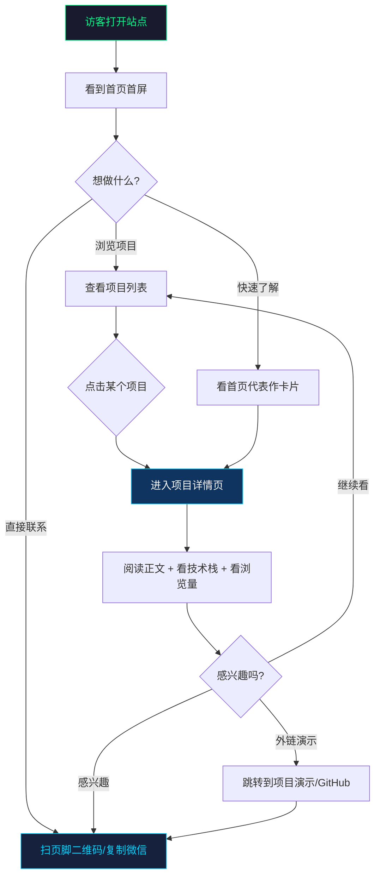
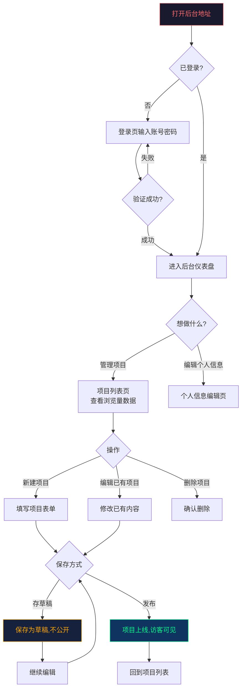

# Personal Center 需求分析文档

> 版本：v2.1  
> 日期：2026-10-20  
> 定位：全功能个人站（接单获客 + 求职展示 + 综合名片 + 技术博客）

---
## 人工需求分析

### 一、公开首页（访客第一眼看到，个人主页）

1. 网站打开就可以看到个人信息、作品数量、让人直观看到
2. 首页展示2-3个重点项目或文章的轮播图或列表，吸引访者
3. 分类显示文章 / 项目等分类，一键切换不需要跳转界面，可暂时只做项目和作品的分类

### 二、详情页（访客点击进去看完整内容）

1. 点进对应项目的详情界面，首先文本的渲染需要支持多种格式，包括富文本、Markdown等，显示介绍内容与详情
2. 另外显示项目涉及到的技术栈、有链接显示可跳转的链接

> MVP 不做评论、点赞，但可做浏览量显示

### 三、管理员后台（只有你登录才能进入，用来管理内容）

1. 需要管理员后台登陆，不需要访客登录
2. 可以编辑个人中心显示的所有内容，例如项目类，可以编辑项目内容、介绍、图片、链接、修改、删除等
3. 可以修改个人信息
4. 需要一个草稿功能，为编辑完的需要保存，但不展示

### 四、基础体验

1. PC / 手机都能正常浏览
2. 访问不存在页面友好提示
3. 界面可以设计得科幻一些，偏工科，组件不要太死板

## 一、需求背景

### 1.1 为什么要做这个站

作为独立开发者，你需要一个线上的"数字名片 + 作品集"，用来：

- **接单获客**：潜在客户从朋友圈/社群/接单平台点进来，3 秒内判断你能不能做、靠不靠谱、怎么联系你
- **求职展示**：HR 或技术面试官看到简历上的链接，点进来直观看到项目深度和技术栈
- **内容沉淀**：写技术文章、记录项目过程，形成长期可检索的个人内容资产
- **能力自证**：站本身就是你前端/全栈能力的证明，比任何口头介绍都有说服力

### 1.2 现状问题

- 目前没有一个统一的对外展示入口，客户想了解你只能靠聊天记录翻
- 项目和作品散落在各个平台（GitHub、朋友圈、接单群），没有汇总
- 每次发新项目或新文章都要改代码、重新部署，成本高

### 1.3 目标

做一个**有视觉冲击力但不喧宾夺主**的个人站：
- 对外：访客打开就能看到你是谁、做过什么、怎么联系
- 对内：你登录后台就能增删改内容，支持草稿，不用动代码

---

## 二、MVP 最小可行功能点

> 原则：**只做最核心的，一口气能做完、上线能用**。不贪多，先跑起来再迭代。

### 2.1 访客端（公开页面）

| 编号 | 功能 | 说明 |
|-----|------|------|
| MVP-01 | 首页首屏 | 个人信息（头像、姓名、一句话简介）+ 工程仪表盘风格 Hero 区 + 联系方式入口 |
| MVP-02 | 重点项目展示 | 首页展示 2-3 个代表作卡片，带缩略图和技术栈标签 |
| MVP-03 | 分类切换 | 项目 / 作品 两个分类，一键切换不跳转页面 |
| MVP-04 | 项目详情页 | 富文本/Markdown 渲染正文 + 技术栈标签 + 外链按钮（演示/GitHub） |
| MVP-05 | 页脚 | 联系方式做成终端命令风格（`$ whoami → 独立开发者`） |
| MVP-06 | 404 页面 | 访问不存在路径时显示有设计感的提示页 |
| MVP-07 | 响应式适配 | PC 和手机都能正常浏览 |
| MVP-08 | 浏览量显示 | 项目详情页显示该项目的阅读数 |

### 2.2 管理端（仅你自己）

| 编号 | 功能 | 说明 |
|-----|------|------|
| MVP-09 | 管理员登录 | 账号密码登录，只有你能进后台 |
| MVP-10 | 项目列表 | 后台看到所有项目，区分已发布和草稿，显示每个项目的浏览量 |
| MVP-11 | 新建/编辑项目 | 表单填写标题、简介、正文、封面图、技术栈、外链 |
| MVP-12 | 删除项目 | 不需要的项目可以删掉 |
| MVP-13 | 草稿功能 | 编辑中可以存草稿，不公开显示，随时继续编辑 |
| MVP-14 | 个人信息编辑 | 修改头像、简介、联系方式 |

### 2.3 MVP 范围边界

**MVP 阶段明确不做：**
- ❌ 文章/博客模块（先只做项目和作品）
- ❌ 评论、点赞、访客留言
- ❌ AI 问答
- ❌ 深色/浅色切换
- ❌ 后台数据看板

---

## 三、后续扩展功能点

> 按优先级排序，MVP 上线后按需迭代。

### P1 — 第二优先级（上线后 1-2 周内加）

| 编号 | 功能 | 说明 | 价值 |
|-----|------|------|------|
| ~~EXT-01~~ | ~~浏览量统计~~ | — | — |
| EXT-02 | 文章/博客模块 | 复用项目的 CRUD 逻辑，扩展文章分类 | 内容沉淀，SEO 引流 |
| EXT-03 | 项目扩展标签 | 角色（独立/团队）、周期（2周/3个月）、类型（商业/练手） | 客户一眼判断项目规模匹配度 |

### P2 — 第三优先级（稳定运营后加）

| 编号 | 功能 | 说明 | 价值 |
|-----|------|------|------|
| EXT-04 | AI 智能问答 | 右下角气泡，访客问"你能做 XX 吗"自动回答 | 24 小时自动接待客户 |
| EXT-05 | 深色/浅色切换 | 默认深色，也支持浅色模式 | 照顾不同用户偏好 |
| EXT-06 | GitHub 贡献图嵌入 | 首页或侧边栏展示 GitHub 活跃度 | 技术能力侧面证明 |
| EXT-07 | 文章目录自动生成 | Markdown 文章右侧自动生成目录 | 长文阅读体验 |

### P3 — 第四优先级（有余力再做）

| 编号 | 功能 | 说明 | 价值 |
|-----|------|------|------|
| EXT-08 | 后台数据看板 | 浏览趋势、访客来源 | 数据驱动优化内容 |
| ~~EXT-09~~ | ~~多语言（中英双语）~~ | — | — |
| EXT-10 | 时间线经历页 | 滚动时间线展示你做过的事 | 替代传统简历页 |

---

## 四、用户操作流程图

### 4.1 访客端流程

### 4.2 管理员端流程

---

## 五、需求功能核对清单

### 访客端

- [ ] MVP-01：首页首屏展示个人信息（头像、姓名、简介）
- [ ] MVP-01：工程仪表盘风格 Hero 区（状态灯、打字机 slogan、网格线背景）
- [ ] MVP-01：首屏有联系方式入口
- [ ] MVP-02：首页展示 2-3 个重点项目卡片
- [ ] MVP-02：项目卡片带缩略图
- [ ] MVP-02：项目卡片带技术栈小标签
- [ ] MVP-03：项目/作品分类一键切换，不跳转页面
- [ ] MVP-04：项目详情页支持 Markdown/富文本渲染
- [ ] MVP-04：项目详情页显示技术栈标签
- [ ] MVP-04：项目详情页有可跳转的外链按钮
- [ ] MVP-05：页脚有终端命令风格的联系方式展示
- [ ] MVP-06：404 页面有设计感，不是浏览器默认页
- [ ] MVP-07：PC 端布局正常
- [ ] MVP-07：手机端布局正常
- [ ] MVP-08：项目详情页显示浏览量数字 

### 管理端

- [ ] MVP-09：管理员登录页（账号密码）
- [ ] MVP-09：未登录访问后台会跳转到登录页
- [ ] MVP-10：后台项目列表区分已发布/草稿状态
- [ ] MVP-10：后台项目列表显示每个项目的浏览量 
- [ ] MVP-11：新建项目表单（标题、简介、正文、封面图、技术栈、外链）
- [ ] MVP-11：编辑已有项目内容
- [ ] MVP-12：删除项目（带确认）
- [ ] MVP-13：草稿保存功能（保存后不公开）
- [ ] MVP-13：草稿可以继续编辑后发布
- [ ] MVP-14：个人信息编辑（头像、简介、联系方式）

### 设计风格

- [ ] 整体深色主题
- [ ] 科幻工科风格基础元素（网格线、扫描线、终端元素）
- [ ] 鼠标移动动态效果（如光斑跟随、视差移动、光标拖尾等）
- [ ] 视觉效果不喧宾夺主，内容可读性优先
- [ ] 组件有辨识度，不用千篇一律的模板

---

*文档结束。*
